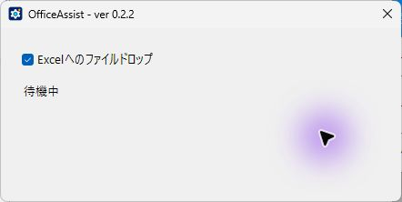
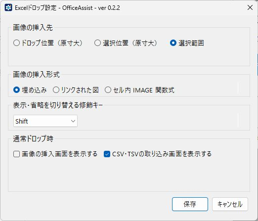
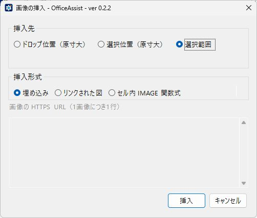
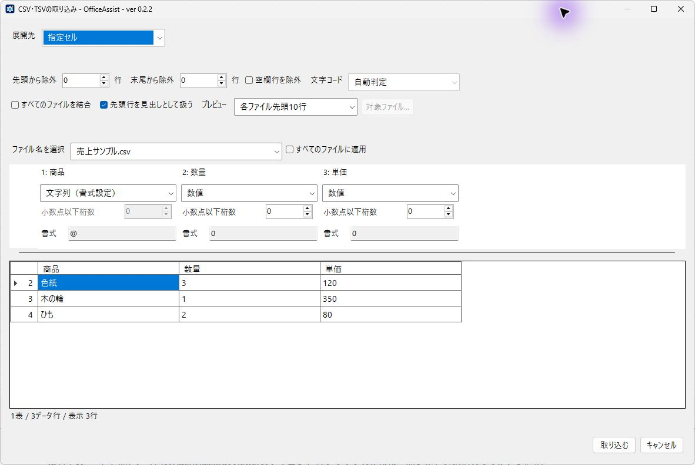
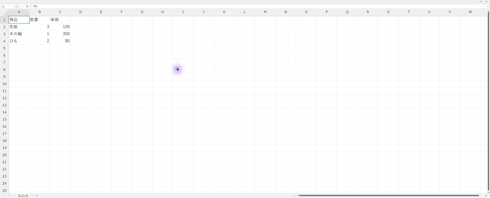

# OfficeAssist

Officeを自分の用途に合わせて使うためのWindows用常駐アプリです。

## Excelへ画像を挿入する

1. OfficeAssistを起動します。通知領域に常駐し、画像ドロップは初期状態でONです。
2. デスクトップ版Excelで編集するブックを開きます。
3. エクスプローラーのフォルダーや、SSCaptureなどの画像ファイルをドラッグできるアプリから、画像をシートへドラッグ＆ドロップします。

通常はダイアログを表示せず、選択範囲に収まる大きさで画像を埋め込みます。修飾キー（初期値はShift）を押しながらドロップすると、挿入先と形式を選んで次回以降の既定値として保存できます。挿入先にはドロップ位置（原寸大）・選択位置（原寸大）・選択範囲を選べます。リンクされた図はExplorerから渡した画像だけが対象です。元画像は移動・変更しません。対応形式はPNG、JPEG、BMP、GIF、TIFFです。

ウィンドウを閉じても通知領域に常駐します。通知領域のアイコンを右クリックすると、画面表示・一時停止・Excelドロップ設定・終了ができます。設定画面を開く修飾キーはShift・Ctrl・Altから選べます。Windowsへの自動起動登録は行いません。

## CSV・TSVを展開する

CSV・TSVをExcelへドロップすると取り込み画面が開きます。v0.2.2以降では新しいブック・新しいシート・指定セル・同名シートへの追記を選べます。除外する行、ファイルの結合、列ごとの形式と小数桁、プレビューするデータの量も設定できます。フォルダ内を再帰的に検索し、フルパスの一覧で取り込むファイルにチェックを付けられます。

文字列は書式設定方式を基本とし、既存データとの衝突を検査します。UTF-8、BOM付きUTF-16、Shift_JISに対応します。詳しい操作は[使い方](docs/guide.md)を参照してください。

文字コードは自動判定、またはUTF-8・UTF-16 LE/BE・Shift_JIS（CP932）の手動指定から選べます。手動指定ではBOMなしUTF-16も読み込めます。

## 画面で見る使い方

画像は0.2.2の画面です。設定画面と挿入条件の画面には、利用者設定を保存しない説明用のプレビューを使っています。Excelの画面は合成CSVを専用ブックに実際に取り込んだ結果です。

### 1. 常駐状態を確認する

通知領域の「開く」から、ファイルドロップの有効・無効と直近の結果を確認できます。

### 2. ドロップ時の動作を決める

通知領域の「Excelドロップ設定」を開き、画像の配置と形式、確認画面の表示、表示を反転する修飾キーを選びます。実際の設定画面では「保存」を押すと設定が反映されます。

### 3. 画像の挿入方法を確認する

設定した修飾キーを押して画像をドロップすると、挿入先と形式を選べます。「選択範囲」は選んだセル範囲に収めます。「埋め込み」は画像をブック内へ保存します。

### 4. CSV・TSVを確認する

取り込み画面で見出し・除外行・列形式を確認します。例では商品を文字列、数量と単価を数値として扱います。内容と展開先を確認してから「取り込む」を押します。

### 5. 結果を確認する

Excelで行数・値・表示形式を確認してからブックを保存します。画像は同じCSVを専用ブックへ取り込んだ結果です。内容を見やすくし、アカウント情報を表示しないよう、Excelのリボンを隠して拡大しています。

## インストール

KotorinToysの一覧でOfficeAssistを選んでインストールできます。[GitHub Releases](https://github.com/KotorinChunChun/OfficeAssist/releases)からセットアップを取得して実行することもできます。v0.2.0以降のセットアップには.NETランタイムを同梱しています。

## 対応環境

Windows 11 x64とインストール済みのデスクトップ版Microsoft Excelが必要です。ExcelとOfficeAssistは通常権限で実行してください。Web版Excelは対象外です。

- [使い方と制限](docs/guide.md)
- [開発者ガイド](docs/development.md)
